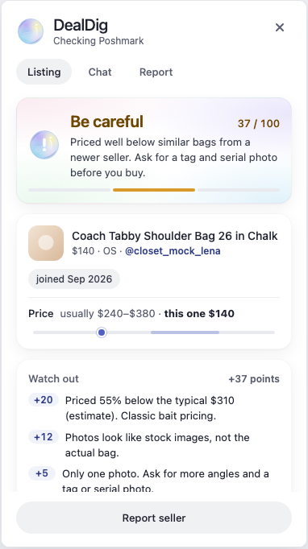
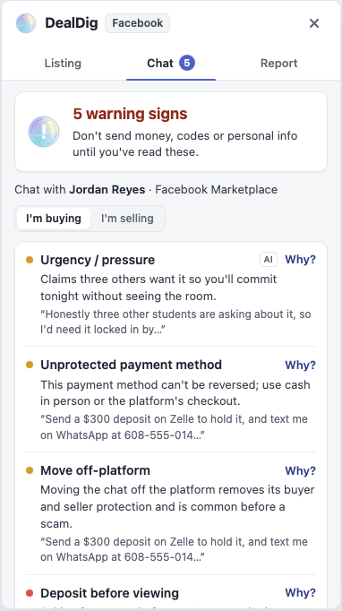
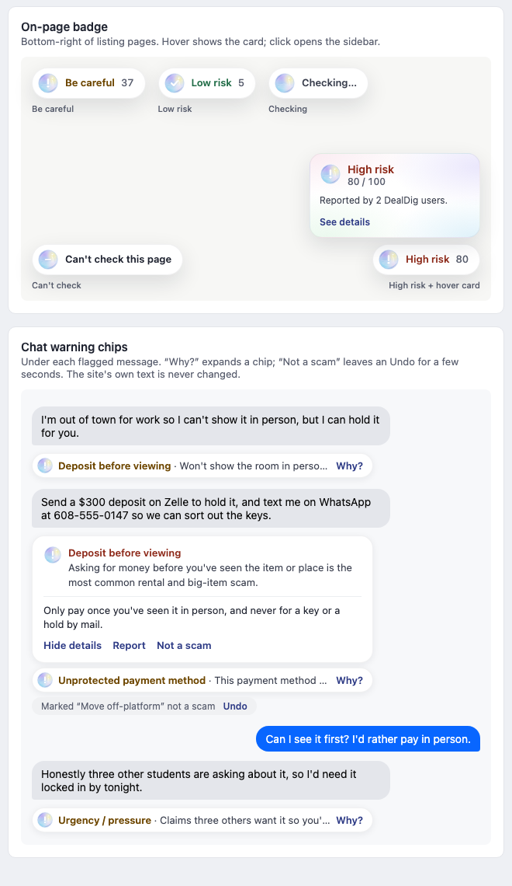

# DealDig

A browser extension that checks online listings for scams and counterfeits before money changes hands. Supported sites: **Poshmark**, **eBay** and **Facebook Marketplace**.

## Run it

```bash
npm install

# 1. Server (terminal 1)
cp server/.env.example server/.env    # add ANTHROPIC_API_KEY, optionally eBay keys (rules-only without them)
npm run server                        # http://localhost:8787

# 2. Extension (terminal 2)
npm run ext                           # rebuilds extension/dist on save
```

Then in Chrome, open `chrome://extensions`, turn on **Developer mode**, click **Load unpacked**, and pick `extension/dist`. Open a `poshmark.com/listing/...`, `ebay.com/itm/...` or `facebook.com/marketplace/item/...` page: a badge appears at the bottom right, and the toolbar icon (or clicking the badge) opens the DealDig sidebar with the full report.

After you change extension code, click the reload icon on the extension card and refresh the page.

`npm test` runs the parser and rule tests. `npm run typecheck` checks both packages.

**Recheck Food/comida:** restart the server after setting credentials, run `npm run build`, reload DealDig at `chrome://extensions`, and refresh the listing. Open the sidebar and click **Check again** to bypass the 10-minute cache. A likely AI flyer plus the $1 placeholder and one photo scores 22 (**Low risk**, marked partial when seller history is unavailable), with a separate image-authenticity disclaimer; an unavailable image/AI check shows **Low risk · partial check**, with the missing checks listed. The server logs how many photos were sent and assessed; `/health` only confirms that credentials are configured. Run `node --import tsx --test server/test/photos-ai.test.ts server/test/images.test.ts server/test/photo-check-repro.test.ts server/test/photo-analysis-pipeline.test.ts` for offline regression checks. The pipeline test mocks Claude responses and does not measure live detection accuracy.

**Chat safety demo:** with the server running, open `http://localhost:8787/demo/chat` (a fictional sublet chat) and click **Next message from Jordan**. Warnings appear under each scam message and in the sidebar's Chat tab. Start the server with `DEMO_MODE=1 npm run server` to replay cached Claude results for the scripted messages (`server/demo/chat-cache.json`), so the demo works without Wi-Fi or an API key.

## Look and feel

The UI is a sidebar (Chrome's side panel) with Listing, Chat and Report tabs, plus two small pieces on the page itself: a badge on listing pages and warning chips under chat messages. The look is deliberately plain: neutral white surfaces, the system font, the bubble logo and one periwinkle accent, with color reserved for risk levels. Tokens live in `extension/src/ui/tokens.css`; the original design brief is `docs/ui-redesign-task.md`.

| Listing: high risk | Listing: be careful | Chat warnings |
|---|---|---|
|  |  |  |



**UI preview:** every state with made-up data, no marketplace or server needed. After loading the extension, open `chrome-extension://<extension id>/preview.html` (the id is on the DealDig card in `chrome://extensions`). Add `#high`, `#chat`, `#onpage`, `#loading`, `#offline` and so on to jump to a state. These screenshots come from that page.

## How it works

```
marketplace page
  └─ content script (extension/src/content/main.ts) picks the reader for the URL
       Poshmark: re-fetches the page HTML → adapters/poshmark.ts
       eBay, Facebook: content/collect.ts copies the DOM into PageData → adapters/ebay.ts, facebook.ts
       └─ background worker (extension/src/background.ts) ── POST /analyze-listing ──▶ server
            stores the result per tab                                  rules.ts   risk score: points per signal, no key needed
            └─ sidebar (side panel) renders it                         claude.ts  item ID, price estimate, red flags, 1-line why
                                                                       prices.ts  eBay Browse API price comparisons
                                                                       db.ts      SQLite: reports + check history
                                                                       photos.ts  stolen-photo matches (dHash index)
                                                                       meetup.ts  safe spots (OSM) + daylight
                                                                       reply.ts   drafted meetup reply
```

- **Why re-fetch the page?** Poshmark puts all listing and seller data in an inline `window.__INITIAL_STATE__` script that deletes itself after running, so the content script can't read it from the DOM. Fetching the same URL again gets the HTML with that script still in it, and it keeps working when you click between listings without a full page load.
- **eBay:** title, price, condition and photos come from the JSON-LD `Product` eBay server-renders; seller name, feedback score, % positive and join date come from the seller card.
- **Facebook Marketplace:** class names are obfuscated, so the adapter only uses headings, links to `/marketplace/profile/<id>`, and text Facebook shows every user ("Listed 3 days ago in ...", "Condition", "Joined Facebook in 2015"). og: tags are used only when `og:url` is the current item, because they go stale as you click between listings. The content script waits until a new item has rendered before reading it.
- **Risk level** (spec §2.4): users only see **Low risk**, **Be careful** or **High risk**, never a number. Behind it, `rules.ts` adds up points per signal (0 safe, 100 very risky) so the level is explainable in code, and the side panel lists the reasons most serious first: price under 50% of typical or under a brand's counterfeit floor +20, account under 30 days +15, no ratings/sales/feedback +10, poor feedback +10, +10 per person who reported the seller (max +30), photo also in another seller's listing +25 (+10 if on another site), text red flags up to +15, one photo +5. Levels: 0-29 low risk, 30-59 be careful, 60+ high risk.
- **Claude's part:** Sonnet 5.5 identifies the item (brand, model, category), estimates its usual price, and lists red flags in the text and photos. Free-text flags share a 15-point cap with the off-platform check. Structured photo findings add fixed points: likely AI-generated/edited +7, possible +3, no photo showing the item +20 (only when every photo was assessed). Placeholder prices add +10 even without AI; they skip the usual price-bait comparison. Ads/events get a neutral banner. Incomplete checks show what was unavailable, and low-risk results are labeled **Low risk · partial check**. Haiku writes a summary for complete checks; partial checks use an explicit fallback.
- **Reports (anonymous):** the buyer picks a reason (deposit before viewing, pay off-platform, fake item...) and can add details. The extension sends a random id made on the device; the server stores only a salted hash of it, so each person counts once per seller and can **undo** or change their report. Reports stop counting after 12 months. **No blocklist:** when 3+ different people report a seller within 30 days, other buyers see a "Flagged" warning with the reason counts, but the seller isn't blocked and the flag adds no extra points. Other users and the AI only ever see reason counts, never what anyone typed.
- **History (on the device only):** every checked listing is saved in `chrome.storage.local` (`extension/src/history.ts`) for 90 days. Coming back shows "You looked at this listing 3 days ago: score 72" and other listings you've seen from the same seller. The "Your history" card has **Forget seller** and **Clear all**; clearing history never removes reports already sent.
- **Stolen photos:** the background worker downloads the first 4 listing photos and computes a 64-bit dHash of each (`shared/photohash.ts`). For reuse matching, the server compares the hashes with every listing DealDig has checked (`photos.ts`, table `photo_hashes`). Within 8 bits counts as the same photo, mirrored copies included. A match with another seller on the same site adds +25; on another site +10, since it may be the seller crossposting, and a matching handle on the other site doesn't count. A photo used by 4+ sellers is treated as a stock photo (info, no points). The side panel also has free **Lens** and **TinEye** links for each photo; the user clicks them, nothing runs automatically.
- **Photo content checks:** the extension also sends resized JPEGs of up to 4 public listing photos (maximum 1024px, quality 0.8) to the server for Claude analysis. The server sends image bytes to Claude, avoiding expired Facebook URLs. If the extension cannot read a photo, the server tries its HTTPS image CDN with a 5-second timeout and 5 MB limit; failed images are skipped and text analysis can still run. DealDig does not store these image bytes. AI-generated/edited is a visual assessment, not proof. The sidebar shows the observation and whether photos were actually checked. Possible or likely findings also show a disclaimer regardless of the risk level: the automated assessment may be wrong, and the buyer can decide whether to ask for an original photo.
- **Check something the seller sent:** for a buyer who got a receipt, tracking screenshot, ID, vehicle title or lease from the seller. The side panel card reads the file **on the device only**, with no upload and no network call. For images (JPEG, PNG, WebP) it reads EXIF and XMP for editing apps (Photoshop, Canva, Snapseed...), "saved after it was taken" dates, and camera vs screenshot, and draws an edit heatmap by re-saving the image and showing what changed (error level analysis). For PDFs it reads which app made the file (online PDF editors are a caution; Word is info, since it's normal for a lease), saves after creation, and created vs modified dates. Findings are "things to check", never a verdict. The buyer picks what kind of document it is and gets how to verify it at the source (call the store using a number they find themselves, type the tracking number into the carrier's site, check the county property records, run the VIN). Code: `extension/src/tamper/`.
- **Meetup helper** (Facebook Marketplace only; Poshmark and eBay are safer kept on-platform): the side panel asks where you're coming from (text only, never GPS), geocodes that and the item's location with OpenStreetMap Nominatim, and searches halfway between with the Overpass API for police stations, libraries, grocery stores, community centers, bank lobbies and cafés. `meetup.ts` ranks them in code (kind, minus 10 points per km) and returns 3 of different kinds; items $250+ or high-risk listings put a police station first. Time options are daylight only (sunset computed from the location). Sonnet 5.5 drafts the reply in a friendly or firm tone, optionally answering the other person's pasted message (declining deposits, payment apps, codes, couriers, off-platform moves); without a key, `reply.ts` fills a template. The user copies it into the chat and sends it themselves. If Overpass is down, a curated Madison list is used.
- **Price check:** with `EBAY_CLIENT_ID` / `EBAY_CLIENT_SECRET` set, the server compares against the median of up to 20 similar eBay listings (Browse API, asking prices). Otherwise it uses Claude's estimate, labeled as one; a low-confidence estimate only adds half the bait points.

## Layout

| Path | What |
|---|---|
| `shared/types.ts` | `Listing`, `RiskReport`, etc. Every site adapter produces a `Listing`. |
| `extension/src/adapters/` | One file per site. Pure functions (HTML or `PageData` → `Listing`), testable in Node. `page.ts` has the shared `PageData` type and parsing helpers. |
| `extension/src/content/` | The content script (`main.ts`), the DOM collector (`collect.ts`) and the on-page badge. |
| `extension/src/chat/` | Chat adapters (one per site), the chat watcher and the inline warning chips. |
| `extension/src/ui/` | The design: tokens, motion, the bubble mark (`bubbleSvg.ts`), and the sidebar's React components (`Panel`, `ListingTab`, `ChatTab`, states). |
| `extension/src/sidepanel/` | The sidebar page: reads the per-tab state from `chrome.storage` and renders `ui/Panel`. |
| `extension/src/preview/` | The UI preview page with mock data. |
| `server/src/rules.ts` | The risk score: `POINTS` table, rule checks, top reasons. |
| `server/src/prices.ts` | Price reference: eBay Browse API comps, or Claude's estimate. |
| `server/src/claude.ts` | Claude prompts and output schemas (listing analysis, score explanation). |
| `shared/photohash.ts` | Photo fingerprint (dHash), distance, mirror, and Lens/TinEye links. |
| `server/src/photos.ts` | Matches a listing's photo hashes against other sellers' listings. |
| `server/src/db.ts` | SQLite tables `reports` (anonymous, one per reporter per seller), `listing_checks` and `photo_hashes`. `DEALDIG_DB=:memory:` for tests. |
| `extension/src/history.ts` | On-device history, the anonymous reporter id, and "my reports". Pure logic in `historyCore.ts`. |
| `server/src/meetup.ts` | Meeting spots: geocoding, Overpass lookup, ranking, sunrise/sunset, curated Madison spots. |
| `server/src/reply.ts` | Drafted meetup reply: Claude, or a template without a key. |
| `extension/src/sidepanel/Meetup.tsx` | The "Meet safely" card. |
| `extension/src/tamper/` | On-device edit checks: `metadata.ts` (image and PDF metadata, pure and tested), `ela.ts` (edit heatmap). UI in `sidepanel/DocCheck.tsx`. |

## API

| Endpoint | Body | Returns |
|---|---|---|
| `GET /health` | | `{ ok, ai }` |
| `POST /analyze-listing` | `{ listing: Listing, photoHashes?: (string \| null)[], photoData?: (string \| null)[] }`. Add `?progress=1` to stream newline-delimited JSON: `{ plan }`, then `{ step }` per stage, then `{ report }` | `RiskReport` |
| `POST /analyze-chat` | `{ ctx: ChatContext }` (max 10 messages, 2,000 chars each) | `ChatReport`: regex flags from `shared/chatPatterns.ts` plus Claude Haiku's, merged in `server/src/chat.ts` |
| `POST /report` | `{ platform, sellerId, sellerUsername, listingId?, category, details?, reporterId }` | `{ ok, community }` |
| `DELETE /report` | `{ platform, sellerId, reporterId }` (undo) | `{ ok, community }` |
| `POST /meetup/spots` | `{ area, listingLocation?, price?, riskLevel? }` | `MeetupSpotsResponse`: 3 spots, center, daylight, notes |
| `POST /meetup/reply` | `DraftReplyInput`: listing, role, tone, spot, time, theirMessage? | `{ reply, aiUsed }` |
| `GET /demo/chat` | | The fictional demo chat page (`extension/demo/chat.html`) |

## Adding another site

1. Add the platform to `PLATFORMS` and `PLATFORM_NAMES` in `shared/types.ts`.
2. Write `extension/src/adapters/<site>.ts`: a URL matcher and a pure parser that returns a `Listing` (from `PageData` for DOM-rendered sites).
3. Add a `SiteReader` for it in `extension/src/content/main.ts` and add the site to `content_scripts.matches` in `public/manifest.json`. Add its image CDN to `host_permissions` so photos can be fingerprinted.
4. Add the platform's context to `PLATFORM_CONTEXT` in `server/src/claude.ts`. If people meet in person there, add it to `LOCAL_PLATFORMS` to show the meetup helper.
5. Add a test in `server/test/` with a fixture shaped like the real page.

## Next up

- Chat/offer checks (`/analyze-chat`): flag off-platform pushes, overpayment, and deposit requests in messages.
- Seller privacy tools: strip photo metadata, blur faces and addresses on the device.
- Read amounts and names from screenshots on the device (Tesseract.js) and compare them with the deal terms.
- Handshake link and receipts.
- Real price comps; web-wide photo search (Cloud Vision) for risky listings.
