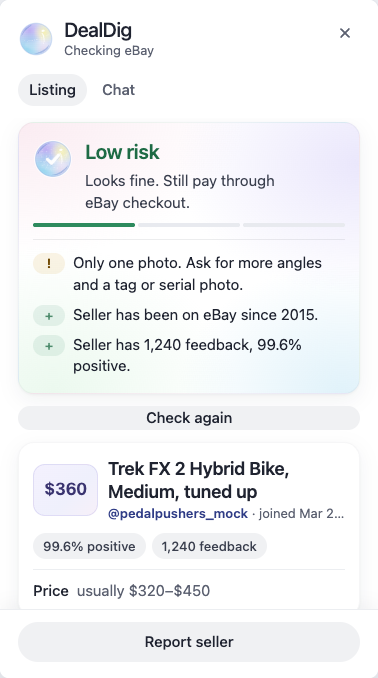
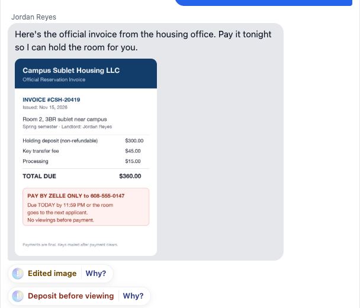
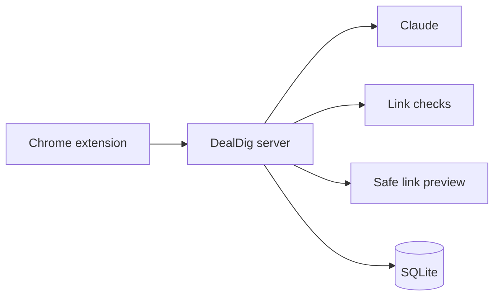

# DealDig

DealDig is a Chrome extension that helps you avoid scams on Poshmark, eBay and Facebook Marketplace. We built it for MadHacks 2026.

It rates each listing as low risk, be careful, or high risk and tells you why. It warns you about scam messages and fake invoices in chats, and it stops sketchy links before they open. Sellers can also clean their photos so they don't leak their location.

 

## How it works



## Run it

```bash
npm install
npx playwright-core install chromium-headless-shell
cp server/.env.example server/.env
npm run server
```

In a second terminal, run `npm run ext`. Then go to `chrome://extensions`, turn on Developer mode, click Load unpacked, and pick `extension/dist`.

Add your Anthropic key to `server/.env` for the full checks. To try it without a real marketplace, open `http://localhost:8787/demo/chat`.
