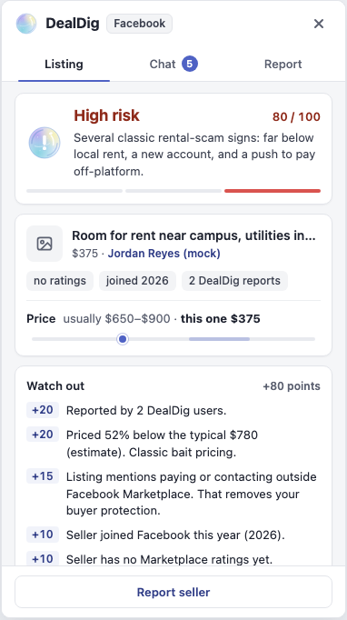

# DealDig

A browser extension that checks online listings for scams and counterfeits before money changes hands. Supported sites: **Poshmark**, **eBay**, **Facebook Marketplace** and **Depop**.

## Run it

```bash
npm install

# 1. Server (terminal 1)
cp server/.env.example server/.env    # add ANTHROPIC_API_KEY, optionally eBay keys (rules-only without them)
npm run server                        # http://localhost:8787

# 2. Extension (terminal 2)
npm run ext                           # rebuilds extension/dist on save
```

Then in Chrome, open `chrome://extensions`, turn on **Developer mode**, click **Load unpacked**, and pick `extension/dist`. Open a `poshmark.com/listing/...`, `ebay.com/itm/...`, `facebook.com/marketplace/item/...` or `depop.com/products/...` page: a badge appears at the bottom right, and the toolbar icon (or clicking the badge) opens the DealDig sidebar with the full report.

After you change extension code, click the reload icon on the extension card and refresh the page.

`npm test` runs the parser and rule tests. `npm run typecheck` checks both packages.

**Chat safety demo:** with the server running, open `http://localhost:8787/demo/chat` (a fictional sublet chat) and click **Next message from Jordan**. Warnings appear under each scam message and in the sidebar's Chat tab. Start the server with `DEMO_MODE=1 npm run server` to replay cached Claude results for the scripted messages (`server/demo/chat-cache.json`), so the demo works without Wi-Fi or an API key.

## Look and feel

The UI is a sidebar (Chrome's side panel) with Listing, Chat and Report tabs, plus two small pieces on the page itself: a badge on listing pages and warning chips under chat messages. The look is deliberately plain: neutral white surfaces, the system font, the bubble logo and one periwinkle accent, with color reserved for risk levels. Tokens live in `extension/src/ui/tokens.css`; the original design brief is `docs/ui-redesign-task.md`.

| Listing: high risk | Listing: be careful | Chat warnings |
|---|---|---|
|  |  |  |


**UI preview:** every state with made-up data, no marketplace or server needed. After loading the extension, open `chrome-extension://<extension id>/preview.html` (the id is on the DealDig card in `chrome://extensions`). Add `#high`, `#chat`, `#onpage`, `#loading`, `#offline` and so on to jump to a state. These screenshots come from that page.

## How it works

```
marketplace page
  └─ content script (extension/src/content/main.ts) picks the reader for the URL
       Poshmark: re-fetches the page HTML → adapters/poshmark.ts
       eBay, Facebook: content/collect.ts copies the DOM into PageData → adapters/ebay.ts, facebook.ts
       └─ background worker (extension/src/background.ts) ── POST /analyze-listing ──▶ server
            stores the result per tab                                  rules.ts   risk score: points per signal, no key needed
            └─ sidebar (side panel) renders it                         claude.ts  item ID, price estimate, red flags, 1-line why
                                                                       prices.ts  eBay Browse API price comparisons
                                                                       db.ts      SQLite: reports + check history
                                                                       photos.ts  stolen-photo matches (dHash index)
                                                                       meetup.ts  safe spots (OSM) + daylight
                                                                       reply.ts   drafted meetup reply
```

- **Why re-fetch the page?** Poshmark puts all listing and seller data in an inline `window.__INITIAL_STATE__` script that deletes itself after running, so the content script can't read it from the DOM. Fetching the same URL again gets the HTML with that script still in it, and it keeps working when you click between listings without a full page load.
- **eBay:** title, price, condition and photos come from the JSON-LD `Product` eBay server-renders; seller name, feedback score, % positive and join date come from the seller card.
- **Facebook Marketplace:** class names are obfuscated, so the adapter only uses headings, links to `/marketplace/profile/<id>`, and text Facebook shows every user ("Listed 3 days ago in ...", "Condition", "Joined Facebook in 2015"). og: tags are used only when `og:url` is the current item, because they go stale as you click between listings. The content script waits until a new item has rendered before reading it.
- **Depop:** class names are build hashes, so the adapter reads JSON-LD (description, photos, price, condition), the `h1`, `data-testid` attributes, the seller card's `"<user>'s shop"` link, "194 sold" / "Active today" text and its `shop rating N stars` aria-label, and the "Ask a question" link for the seller and product ids. JSON-LD is used only when its URL is the current item, since Depop swaps pages without reloading. Depop shows no join date, so the seller signals come from reviews (count and star rating) and items sold.
- **Risk score** (spec §2.4): users see the score out of 100 (0 = no red flags, 100 = very risky) next to its level, **Low risk**, **Be careful** or **High risk**, on the badge and in the side panel. `rules.ts` adds up points per signal, and the side panel's "Why N/100" card lists every reason with its points and proof links (the duplicate listing, the page with the same text), adding up to the score: price under 50% of typical or under a brand's counterfeit floor +20, account under 30 days +15, no ratings/sales/feedback +10, poor feedback +10, +10 per person who reported the seller (max +30), photo also in another seller's listing +25 (+10 if on another site), text red flags up to +15, one photo +5. Levels: 0-29 low risk, 30-59 be careful, 60+ high risk.
- **Claude's part:** Sonnet 5.5 identifies the item (brand, model, category), estimates its usual price, and lists red flags in the text and photos. It can add at most 15 points, shared with the regex off-platform check, so a prompt-injected listing can't talk its way to a low score. Haiku 5.5 then writes a 2-3 sentence explanation of the final score that cites its evidence (who else posted the photo, the price gap...). Without a key, the summary is the score plus the biggest reasons with their points.
- **Reports (anonymous):** the buyer picks a reason (deposit before viewing, pay off-platform, fake item...) and can add details. The extension sends a random id made on the device; the server stores only a salted hash of it, so each person counts once per seller and can **undo** or change their report. Reports stop counting after 12 months. **No blocklist:** when 3+ different people report a seller within 30 days, other buyers see a "Flagged" warning with the reason counts, but the seller isn't blocked and the flag adds no extra points. Other users and the AI only ever see reason counts, never what anyone typed.
- **History (on the device only):** every checked listing is saved in `chrome.storage.local` (`extension/src/history.ts`) for 90 days. Coming back shows "You looked at this listing 3 days ago: score 72" and other listings you've seen from the same seller. The "Your history" card has **Forget seller** and **Clear all**; clearing history never removes reports already sent.
- **Phishing links in chats:** links from the other person get three checks beyond "this leaves the marketplace". On the device (`shared/linkCheck.ts`), **look-alike domains**: brand names with swapped characters (`faceb00k-pay.com`, `rnercari.com`), near-misspellings (`paypai`, `vemno`), a brand inside a fake domain (`zelle-payments-support.com`, `paypal.com.account-verify.top`), other alphabets (punycode), bare IP addresses, a real-looking address before an `@`, and real sites that forward you on (`google.com/url?q=...`). On the server (`server/src/links.ts`): link shorteners are followed with HEAD requests to the real destination; the bare domain goes to public registration records (RDAP via rdap.org) and a domain under 30 days old is red, under 90 amber; and with `GOOGLE_SAFE_BROWSING_KEY` set, the link (without its query string) is checked against Google Safe Browsing. The message text never leaves the server, lookups have a 5-second budget, and only code raises these warnings, never the AI. `npm run eval:links -w server` prints which evasions are caught and missed.
- **Link guard (stops the page, not just a warning):** when a link is opened **from a marketplace tab or chat** (or a tab opened from one), the background worker checks the destination as it starts loading: look-alikes on the device, then `POST /check-url` on the server (brand-new domain, Google Safe Browsing, and Cloudflare's security DNS resolver, which answers `0.0.0.0` for known malware and phishing domains: a free threat-list check, domain only). A bad verdict sends the tab to DealDig's warning page (`blocked.html`) with **Go back** and **Continue anyway** (allowed for the session). Domains a chat check already flagged red get a Chrome blocking rule (`declarativeNetRequest` session rule), so they never load. Facebook's `l.facebook.com/l.php?u=…` and Google's `/url?q=…` wrappers are unwrapped first. The rest of the user's browsing is never checked or sent. An extension can't change the computer's DNS, so the warning page links to Chrome's secure-DNS setting for a filtering provider (Cloudflare 1.1.1.2, Quad9). Code: `extension/src/guard.ts`, `guardCore.ts`.
- **Stolen photos:** the background worker downloads the first 4 listing photos and computes a 64-bit dHash of each (`shared/photohash.ts`). Only the hashes go to the server, which compares them with every listing DealDig has checked (`photos.ts`, table `photo_hashes`). Within 8 bits counts as the same photo, mirrored copies included. A match with another seller on the same site adds +25; on another site +10, since it may be the seller crossposting, and a matching handle on the other site doesn't count. A photo used by 4+ sellers is treated as a stock photo (info, no points). The side panel also has free **Lens** and **TinEye** links for each photo; the user clicks them, nothing runs automatically.
- **Photos and text found elsewhere on the web** (`webPhotos.ts`, `textMatch.ts`, `sellerIdentity.ts`): with `GOOGLE_VISION_API_KEY` set, the first 3 photos go through a reverse image search (Cloud Vision Web Detection). For each page that shows the same photo, the server works out who posted it: from the URL (`poshmark.com/closet/<user>`, `depop.com/products/<user>-...`), from DealDig's own index, or by opening the listing page and reading the seller. **The same seller's own pages are fine** (crossposting) and show as a good sign. **A different seller's listing or post adds +25** with a link to it as proof; a marketplace listing whose seller can't be read +10; a stock-photo site +10 and other websites +8 for used items (0 for new items, where catalog photos are normal); a photo shared by 4+ accounts is treated as a catalog photo (+10 for used). All photo findings together are capped at +30. Descriptions are compared too: against every description DealDig has checked (table `listing_texts`), and, with Claude available, by a web search (Claude's web search tool) for the two most distinctive sentences. Every web hit is opened and kept only if the text is really on the page. Another seller's copy adds +15, quoted and linked; an unknown seller's +5. Boilerplate ("smoke free home", "bundle to save") and short descriptions are ignored. Lookups are cached for 7 days (table `web_cache`). The server only opens public http(s) pages, never localhost or private IPs.
- **AI-generated photos** (`aiImage.ts`): Claude looks for visible tells (warped logo text, melted hardware, impossible shadows), the optional Sightengine detector (`SIGHTENGINE_API_USER`/`SECRET`) scores the first 2 photos, and the reverse image search notes AI-art sites. Any of these shows a notice with the evidence. **It never changes the score**: detectors make mistakes, so the user decides.
- **Check something the seller sent:** for a buyer who got a receipt, tracking screenshot, ID, vehicle title or lease from the seller. The side panel card reads the file **on the device only**, with no upload and no network call. For images (JPEG, PNG, WebP) it reads EXIF and XMP for editing apps (Photoshop, Canva, Snapseed...), "saved after it was taken" dates, and camera vs screenshot, and draws an edit heatmap by re-saving the image and showing what changed (error level analysis). For PDFs it reads which app made the file (online PDF editors are a caution; Word is info, since it's normal for a lease), saves after creation, and created vs modified dates. Findings are "things to check", never a verdict. The buyer picks what kind of document it is and gets how to verify it at the source (call the store using a number they find themselves, type the tracking number into the carrier's site, check the county property records, run the VIN). Code: `extension/src/tamper/`.
- **Meetup helper** (Facebook Marketplace only; Poshmark and eBay are safer kept on-platform): the side panel asks where you're coming from (text only, never GPS), geocodes that and the item's location with OpenStreetMap Nominatim, and searches halfway between with the Overpass API for police stations, libraries, grocery stores, community centers, bank lobbies and cafés. `meetup.ts` ranks them in code (kind, minus 10 points per km) and returns 3 of different kinds; items $250+ or high-risk listings put a police station first. Time options are daylight only (sunset computed from the location). Sonnet 5.5 drafts the reply in a friendly or firm tone, optionally answering the other person's pasted message (declining deposits, payment apps, codes, couriers, off-platform moves); without a key, `reply.ts` fills a template. The user copies it into the chat and sends it themselves. If Overpass is down, a curated Madison list is used.
- **Price check:** with `EBAY_CLIENT_ID` / `EBAY_CLIENT_SECRET` set, the server compares against the median of up to 20 similar eBay listings (Browse API, asking prices). Otherwise it uses Claude's estimate, labeled as one; a low-confidence estimate only adds half the bait points.

- **Photo privacy** (sellers only): when the active tab is a create/edit-listing page (`extension/src/sellPages.ts`), the side panel switches from the listing check to this tool and the page shows a "Check your photos before posting" badge. Sellers drop in listing photos before uploading them. Runs entirely in the extension; photos are never uploaded, and all engines and models ship inside the extension (no CDN, no remote code).
  - *Upload guard* (`extension/src/content/uploadGuard.ts`): sites upload photos the moment they're picked, so the guard catches them at that moment instead. A capture-phase `input`/`change` listener on `window` runs before any of the page's own listeners and stops the event, copies the files into memory and empties the input. The page badge says "Holding N photos" (with a Skip button), and the side panel pulls the files (one message per file, base64) and checks them. **Use N clean photos in my listing** sends back only copies that passed the metadata re-check; the guard puts them into the same `<input>` with a `DataTransfer` and fires `input` + `change` again, so the site uploads only clean files. **Skip** puts the originals back the same way. Photos that can't be cleaned (e.g. HEIC) are left out unless the seller skips. Drag-and-drop uploads aren't intercepted yet.
  - *Metadata:* `exifr` reads EXIF, GPS, XMP, IPTC, PNG chunks and the embedded preview thumbnail (which can still show a cropped-out area). Findings are explained in plain words, GPS first.
  - *Faces:* MediaPipe BlazeFace (WASM) runs on the whole photo plus a 3×3 grid of overlapping tiles so small background faces are found; duplicates are merged with non-maximum suppression.
  - *Text:* Tesseract OCR (WASM). Words are filtered by confidence, rows are split at big gaps (OCR on photos glues junk from fabric and shadows onto real lines), and each piece is checked for addresses, ZIP codes, phone numbers, emails, tracking numbers and house numbers. An address grows into the whole mailing label around it, so the name line is covered too. Other text is shown as an unchecked suggestion.
  - *Covering:* text gets solid boxes and faces are reduced to an 8×8 grid with random noise, then smoothed. Plain blur or fine pixelation can be reversed (e.g. Depix rebuilds pixelated text). Users can uncheck any box or draw their own.
  - *Clean copy:* the photo is redrawn on a fresh canvas and saved as a new JPEG, so no metadata is carried over. The clean copy is then re-read to **verify** it has 0 metadata fields and no location before the download button is shown as safe.

## Layout

| Path | What |
|---|---|
| `shared/types.ts` | `Listing`, `RiskReport`, etc. Every site adapter produces a `Listing`. |
| `extension/src/adapters/` | One file per site. Pure functions (HTML or `PageData` → `Listing`), testable in Node. `page.ts` has the shared `PageData` type and parsing helpers. |
| `extension/src/content/` | The content script (`main.ts`), the DOM collector (`collect.ts`) and the on-page badge. |
| `extension/src/chat/` | Chat adapters (one per site), the chat watcher and the inline warning chips. |
| `extension/src/ui/` | The design: tokens, motion, the bubble mark (`bubbleSvg.ts`), and the sidebar's React components (`Panel`, `ListingTab`, `ChatTab`, states). |
| `extension/src/sidepanel/` | The sidebar page: reads the per-tab state from `chrome.storage` and renders `ui/Panel`. |
| `extension/src/preview/` | The UI preview page with mock data. |
| `server/src/rules.ts` | The risk score: `POINTS` table, rule checks, top reasons. |
| `server/src/prices.ts` | Price reference: eBay Browse API comps, or Claude's estimate. |
| `server/src/claude.ts` | Claude prompts and output schemas (listing analysis, score explanation). |
| `shared/linkCheck.ts` | On-device look-alike domain check (brands, swaps, typos, punycode, `@` disguises, open redirects). |
| `server/src/links.ts` | Link lookups for chats and the link guard: shortener redirects, domain age (RDAP), Google Safe Browsing, Cloudflare's filtering resolver. |
| `extension/src/guard.ts` | Link guard: checks pages opened from marketplace tabs, blocking rules for flagged domains, the warning page (`src/blocked/`). |
| `shared/photohash.ts` | Photo fingerprint (dHash), distance, mirror, and Lens/TinEye links. |
| `server/src/photos.ts` | Matches a listing's photo hashes against other sellers' listings. |
| `server/src/webPhotos.ts` | Reverse image search (Cloud Vision) and labelling each page that shows the photo. |
| `server/src/textMatch.ts` | Copied-description check: DealDig's index, web search hits confirmed on the page. |
| `server/src/sellerIdentity.ts` | Who posted a page: same seller, a different seller, or unknown. |
| `server/src/aiImage.ts` | AI-generated photo notice (Claude, optional detector, AI-art sites). Never scored. |
| `server/src/webFetch.ts` | Locked-down page fetch: public http(s) only, timeouts, size cap. |
| `server/src/db.ts` | SQLite tables `reports` (anonymous, one per reporter per seller), `listing_checks`, `photo_hashes`, `listing_texts` and `web_cache`. `DEALDIG_DB=:memory:` for tests. |
| `extension/src/history.ts` | On-device history, the anonymous reporter id, and "my reports". Pure logic in `historyCore.ts`. |
| `server/src/meetup.ts` | Meeting spots: geocoding, Overpass lookup, ranking, sunrise/sunset, curated Madison spots. |
| `server/src/reply.ts` | Drafted meetup reply: Claude, or a template without a key. |
| `extension/src/sidepanel/Meetup.tsx` | The "Meet safely" card. |
| `extension/src/tamper/` | On-device edit checks: `metadata.ts` (image and PDF metadata, pure and tested), `ela.ts` (edit heatmap). UI in `sidepanel/DocCheck.tsx`. |
| `extension/src/sidepanel/PhotoPrivacy.tsx` | The photo privacy tool (shown on sell pages). |
| `extension/src/content/uploadGuard.ts` | Holds photos picked on sell pages until they're cleaned (or skipped). |
| `extension/src/sellPages.ts` | URL patterns for each site's create/edit-listing pages. |
| `extension/src/privacy/` | Photo privacy: `metadata.ts`/`summarize.ts` (hidden data), `detect.ts` (faces, text), `pii.ts` (which text is personal, label grouping), `redact.ts` (clean copy), `geometry.ts` (box math). |
| `extension/public/models/` | BlazeFace face model (MediaPipe). WASM engines and OCR data are copied from `node_modules` by `build.mjs`. |

## API

| Endpoint | Body | Returns |
|---|---|---|
| `GET /health` | | `{ ok, ai }` |
| `POST /analyze-listing` | `{ listing: Listing, photoHashes?: (string \| null)[] }`. Add `?progress=1` to stream newline-delimited JSON: `{ plan }`, then `{ step }` per stage, then `{ report }` | `RiskReport` |
| `POST /analyze-chat` | `{ ctx: ChatContext }` (max 10 messages, 2,000 chars each) | `ChatReport`: regex flags from `shared/chatPatterns.ts` plus Claude Haiku's, merged in `server/src/chat.ts` |
| `POST /report` | `{ platform, sellerId, sellerUsername, listingId?, category, details?, reporterId }` | `{ ok, community }` |
| `DELETE /report` | `{ platform, sellerId, reporterId }` (undo) | `{ ok, community }` |
| `POST /meetup/spots` | `{ area, listingLocation?, price?, riskLevel? }` | `MeetupSpotsResponse`: 3 spots, center, daylight, notes |
| `POST /meetup/reply` | `DraftReplyInput`: listing, role, tone, spot, time, theirMessage? | `{ reply, aiUsed }` |
| `POST /check-url` | `{ url }` (only links opened from a marketplace tab or chat) | `{ url, domain, verdict: "block" \| "ok", reasons[] }` |
| `GET /demo/chat` | | The fictional demo chat page (`extension/demo/chat.html`) |

## Adding another site

1. Add the platform to `PLATFORMS` and `PLATFORM_NAMES` in `shared/types.ts`.
2. Write `extension/src/adapters/<site>.ts`: a URL matcher and a pure parser that returns a `Listing` (from `PageData` for DOM-rendered sites).
3. Add a `SiteReader` for it in `extension/src/content/main.ts` and add the site to `content_scripts.matches` in `public/manifest.json`. Add its image CDN to `host_permissions` so photos can be fingerprinted.
4. Add the platform's context to `PLATFORM_CONTEXT` in `server/src/claude.ts`. If people meet in person there, add it to `LOCAL_PLATFORMS` to show the meetup helper.
5. Add a test in `server/test/` with a fixture shaped like the real page.

## Next up

- Chat/offer checks (`/analyze-chat`): flag off-platform pushes, overpayment, and deposit requests in messages.
- Read amounts and names from screenshots on the device (Tesseract.js) and compare them with the deal terms.
- Upload guard: also catch drag-and-drop photo uploads; confirm it on the live Poshmark, eBay and Facebook sell forms.
- Handshake link and receipts.
- Real price comps.
