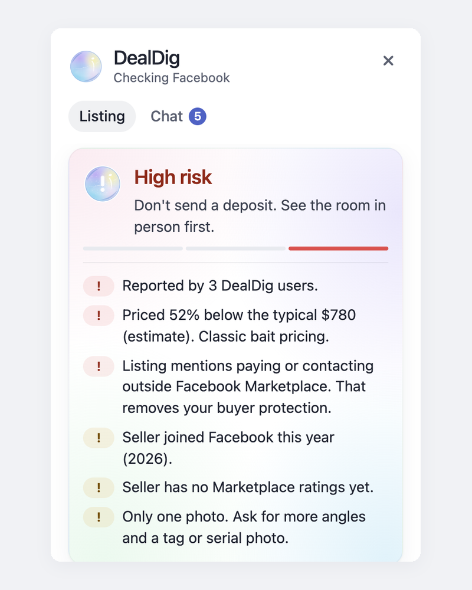
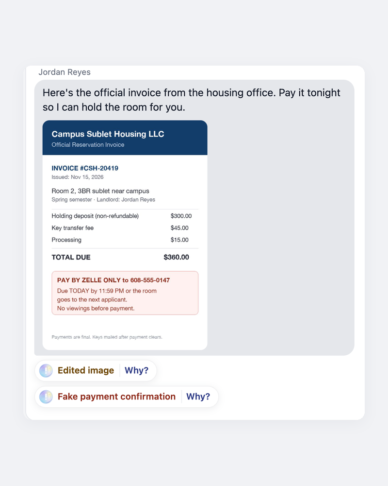
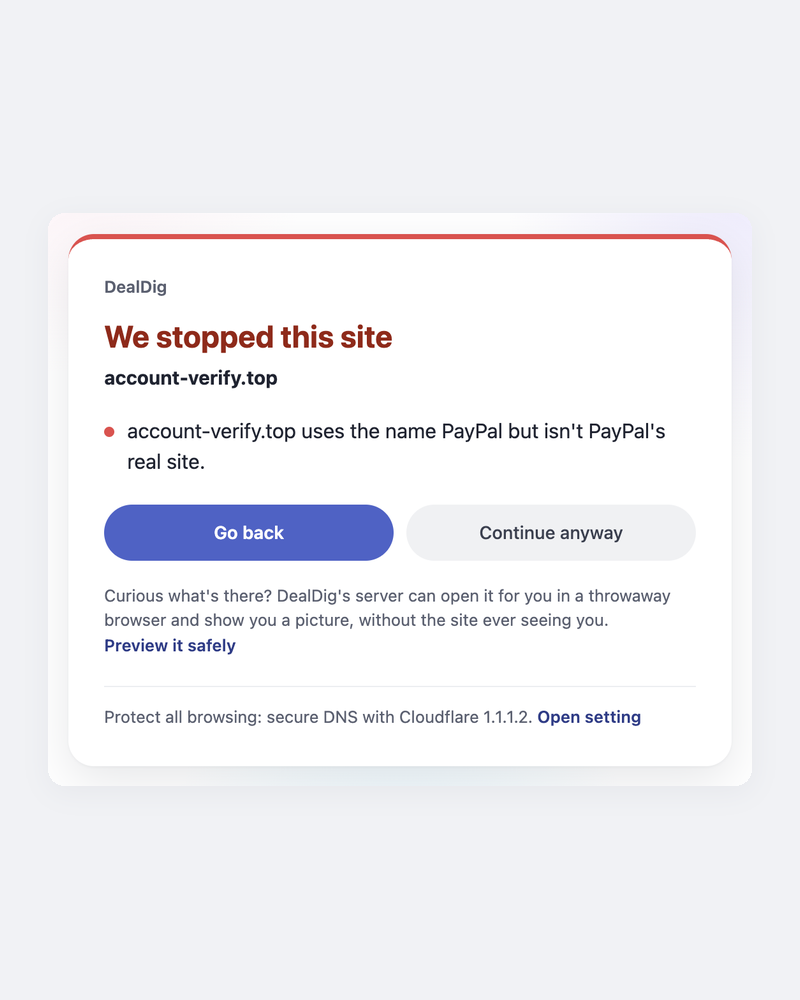
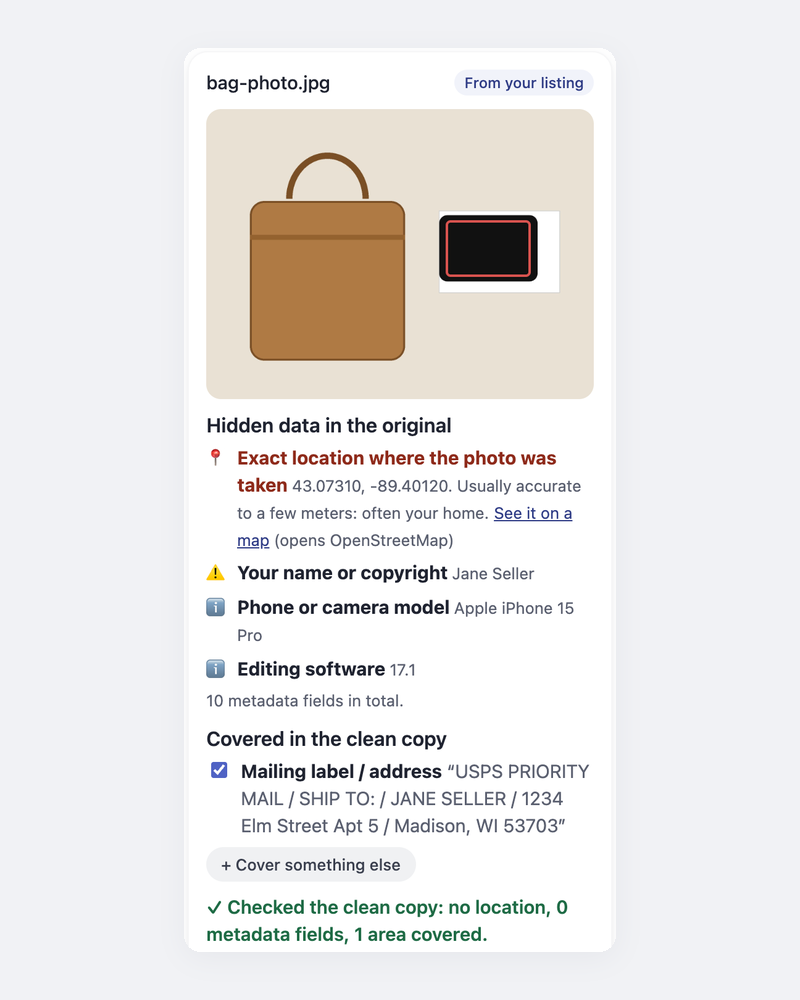
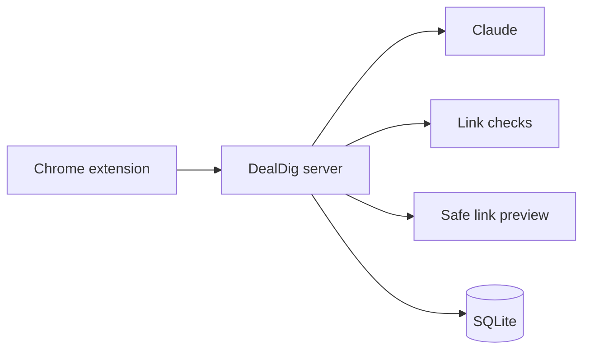

# DealDig

DealDig is a Chrome extension that helps you buy and sell safely on Poshmark, eBay and Facebook Marketplace. It catches scams before you send money and keeps your personal info from leaking. We built it for MadHacks 2026.

<table>
  <tr>
    <td width="50%" valign="top">
      <b>Listing check</b><br>
      Every listing gets a risk level with the reasons right under it.<br><br>
      
    </td>
    <td width="50%" valign="top">
      <b>Chat warnings</b><br>
      Scam messages and edited invoices get flagged in the chat.<br><br>
      
    </td>
  </tr>
  <tr>
    <td width="50%" valign="top">
      <b>Link guard</b><br>
      Fake sites get stopped before they load, and you can preview them safely.<br><br>
      
    </td>
    <td width="50%" valign="top">
      <b>Seller photo privacy</b><br>
      Your location and address get removed from photos before you post.<br><br>
      
    </td>
  </tr>
</table>

## How it works

The extension reads the page you're on and sends only public listing info to our server. The server checks it with Claude, looks up links, and sends back what it found. Photo cleaning happens on your own computer.



## Run it

```bash
npm install
npx playwright-core install chromium-headless-shell
cp server/.env.example server/.env
npm run server
```

In a second terminal, run `npm run ext`. Then go to `chrome://extensions`, turn on Developer mode, click Load unpacked, and pick `extension/dist`.

Add your Anthropic key to `server/.env` for the full checks. To try it without a real marketplace, open `http://localhost:8787/demo/chat`.
