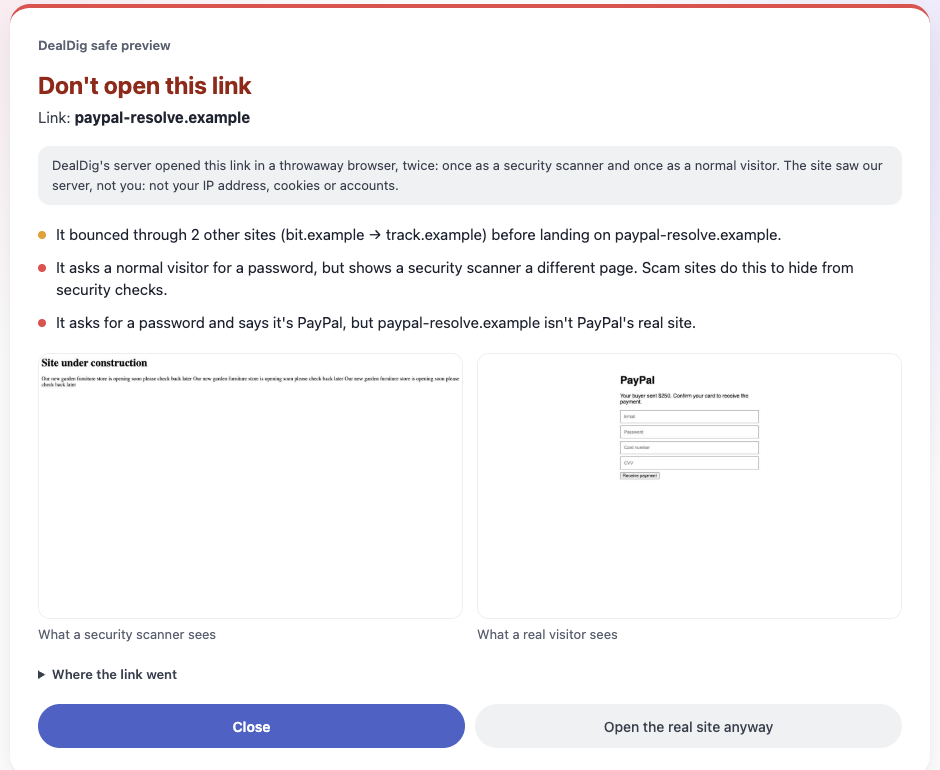
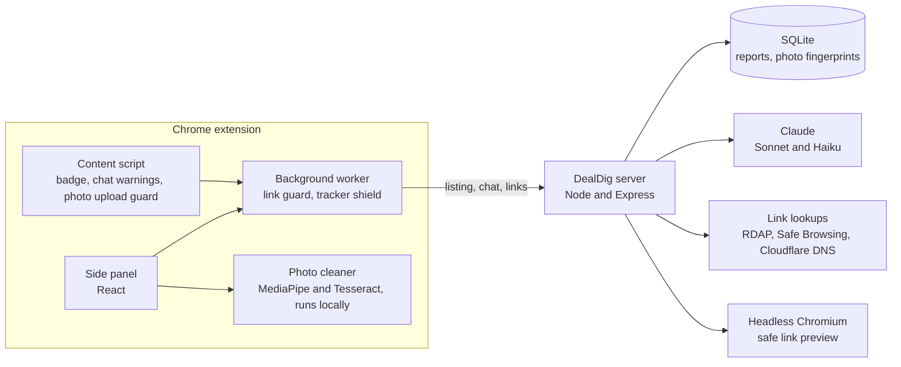

# DealDig

DealDig is a Chrome extension we built for MadHacks 2026. It helps people buy and sell on Poshmark, eBay and Facebook Marketplace without getting scammed, and it tries to keep their info private while they do it.

When you open a listing, DealDig looks at the seller, the price and the photos, and tells you if it's low risk, something to be careful about, or high risk. The reasons show up right under that, so you can decide for yourself.


It also keeps an eye on your chats. If someone wants a deposit before you've seen the place, tries to move you to Zelle or WhatsApp, or sends a sketchy link, a small warning shows up under that message. If they send a picture of an invoice or receipt that was saved in Photoshop, DealDig flags that too.


Links from a chat get checked before they open. If one is pretending to be PayPal or the site was made last week, DealDig stops it and shows a warning page instead. You can also right-click any link and pick "Preview link safely with DealDig." Our server opens the link in a throwaway browser, takes a screenshot, and looks for fake login and card forms. It visits twice, once like a security scanner and once like a regular person, because a lot of scam sites show scanners a blank page and only show real people the fake login. The site only ever sees our server, never you.



Sellers get help too. Before you post photos, DealDig can strip out the hidden location data and blur faces and addresses, and all of that happens on your own computer. While you browse, it blocks trackers on listing pages and shows you exactly what it sent to our server, which is only the public listing info.

## How it fits together



The extension is TypeScript and React, bundled with esbuild. The server is Node with Express and a small SQLite database. Claude reads the listing and the chat, and the risk level itself is worked out in plain code so every warning can be explained.

## Running it

You need Node and Chrome. Run the server in one terminal and the extension build in another.

```bash
npm install
npx playwright-core install chromium-headless-shell
cp server/.env.example server/.env
npm run server
```

```bash
npm run ext
```

Then go to `chrome://extensions`, turn on Developer mode, click Load unpacked, and pick the `extension/dist` folder. After you change code, hit reload on the DealDig card and refresh the page.

The server works with no keys, but it's a lot better with an Anthropic key in `server/.env`. The other keys in that file turn on extra checks like Safe Browsing and reverse image search.

If you want to try it without a real marketplace, open `http://localhost:8787/demo/chat` and click "Next message from Jordan" or "Send invoice as Jordan." `npm test` runs the tests, and there's more detail on how everything works in the `docs` folder.
